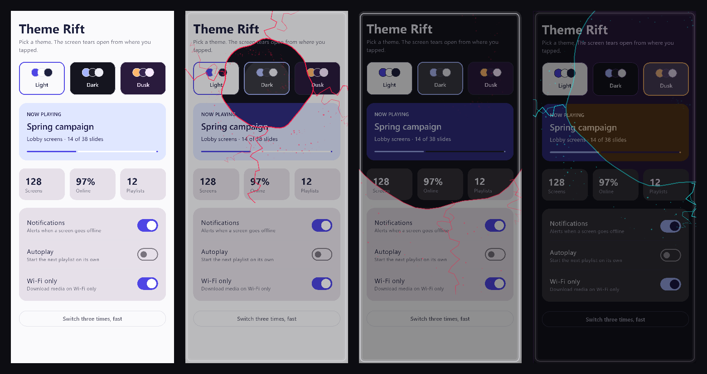

# Theme Rift

A theme switch for Compose Multiplatform that tears the screen open where the user tapped. The new
theme shows through a ragged hole that bursts outward, with lightning crackling off its edge, sparks
spiralling in, the screen shaking, and a glow rattling round the border.



- **One composable.** Wrap your theme in `ThemeRift` and you're done. No second copy of your UI is
  composed, and its state survives every switch.
- **Any theme state.** A `Boolean`, an enum, a palette object: anything you can compare with `equals`.
- **Android, iOS and desktop** from one `commonMain` dependency.
- **Built for slow phones.** It was tuned on a mid-range MediaTek Helio G99 (see
  [How it works](#how-it-works)).

## Install

### JitPack

```kotlin
// settings.gradle.kts
dependencyResolutionManagement {
    repositories {
        google()
        mavenCentral()
        maven("https://jitpack.io")
    }
}
```

```kotlin
// build.gradle.kts of your shared (or Android) module
kotlin {
    sourceSets {
        commonMain.dependencies {
            implementation("com.github.M1nexoff.theme-rift:theme-rift:0.1.0")
        }
    }
}
```

In an Android-only project, put the same line in `dependencies { implementation(...) }`.

### Maven Central

Once a release is on Maven Central (see [PUBLISHING.md](PUBLISHING.md)), no extra repository is
needed:

```kotlin
implementation("io.github.m1nexoff:theme-rift:0.1.0")
```

## Use

Put `ThemeRift` at the root, around your theme:

```kotlin
@Composable
fun App() {
    var dark by rememberSaveable { mutableStateOf(false) }

    ThemeRift(
        targetState = dark,
        colors = { isDark ->
            if (isDark) {
                RiftColors(background = DarkColors.background, glow = DarkColors.onBackground)
            } else {
                RiftColors(background = LightColors.background, glow = LightColors.onBackground)
            }
        },
        modifier = Modifier.fillMaxSize(),
    ) { isDark ->
        MaterialTheme(colorScheme = if (isDark) DarkColors else LightColors) {
            Surface(Modifier.fillMaxSize()) {
                Screen(onToggleTheme = { dark = !dark })
            }
        }
    }
}
```

That's all. The rift opens from wherever the user's finger last went down, which is usually the
toggle they just tapped.

### Three rules

1. **Build the theme from the lambda's parameter, never from `targetState`.** After a switch,
   `content` keeps the old state for one more frame so that frame can be frozen and torn open. A
   theme read straight from your own state would already be the new one, and the rift would tear
   open nothing.
2. **Paint an opaque background.** The rift tears the frame your content drew. A `Surface` or
   `Modifier.background` filling the screen does it.
3. **Wrap the whole screen.** `ThemeRift` covers only its own bounds, and the effect is meant to fill
   the screen.

### Colours

`colors` is called once per switch, for the theme being switched *to*:

| `RiftColors` | What it colours | Good choice |
|---|---|---|
| `background` | The thin strips the shake uncovers at the screen's edges | The theme's background |
| `glow` | The rattling frame round the screen | The theme's content colour (`onBackground`) |
| `lightning` | Bolts, sparks and the rim of the hole | Defaults to a hot red, `RiftColors.DefaultLightning` |
| `scrim` | Dims the screen while the rift opens, so the lightning reads on light themes | Defaults to black |

Pick `lightning` per theme when the red gets lost. The demo's violet *Dusk* theme uses cyan.

### More than two themes

`targetState` can be any type, so a theme picker needs nothing special:

```kotlin
enum class AppTheme(val scheme: ColorScheme) { Light(...), Dark(...), Dusk(...) }

var theme by rememberSaveable { mutableStateOf(AppTheme.Light) }

ThemeRift(
    targetState = theme,
    colors = { RiftColors(background = it.scheme.background, glow = it.scheme.onBackground) },
) { shown ->
    MaterialTheme(colorScheme = shown.scheme) { /* ... */ }
}
```

### Behaviour worth knowing

- **Switches with no touch behind them** open from the centre. That covers the system going dark,
  or a switch fired from code.
- **Switching again mid-rift** doesn't cut the running rift short. The new one tears open from the
  new touch, and the older one keeps growing wherever the new one hasn't reached. Up to three rifts
  run at once; a fourth retires the oldest.
- **Animations off.** When the composition's `MotionDurationScale` is 0, which on Android means
  animations are turned off in the system settings, the theme changes at once with no rift.
- **Timing.** A switch takes 2.2 s end to end. The hole covers the screen in about the first
  second, then the lightning dies down.

### Performance note

On the frame the new theme lands, everything that reads it recomposes. `MaterialTheme` provides its
colour scheme through a static composition local, so with it that is everything below it. On a slow
phone that one frame can hitch just as the rift starts. If it does, provide your colours through a
dynamic `compositionLocalOf`, so only what actually reads a colour recomposes.

## Platforms

| | |
|---|---|
| Android | minSdk 23 |
| iOS | `iosArm64`, `iosSimulatorArm64` |
| Desktop | JVM 11+ |
| Kotlin | 2.2.20 or newer |
| Compose Multiplatform | 1.11.1 or newer |

## Demo

The `demo/` folder holds a settings-style screen with three themes, toggles whose state survives
every switch, and a button that switches three times in a row to show rifts overlapping. The screen is shared, with a
thin host per platform:

| Platform | Run it |
|---|---|
| Desktop | `./gradlew :demo:desktopApp:run` |
| Android | `./gradlew :demo:androidApp:installDebug`. Judge smoothness on `installRelease` (minified, debug-signed), never on a debug build. |
| iOS | Open `demo/iosApp/iosApp.xcodeproj` in Xcode on a Mac and run. To run on a device, set your team in `demo/iosApp/Configuration/Config.xcconfig`. |

The Android SDK location goes in `local.properties` (`sdk.dir=...`), as in any Android project.

## How it works

The UI is composed once. On a switch, `ThemeRift` records the current frame into a bitmap. The UI
then recomposes in the new theme, and the bitmap is drawn over it with a growing hole cut out. The
lightning and dimming start on the very next frame, over the still-live old theme, so the tap gets an
immediate answer.

The effect is drawn by hand on the Compose canvas. The first version ran badly on a Helio G99, and
two things cost the most:

- **Clipping the frozen frame to the ragged hole** cost a full-screen coverage mask every frame, 25 to
  30 ms at the 90th percentile. On Android 10+ the frame is instead drawn as a textured triangle
  mesh covering exactly the outside of the hole (`OutsideMesh`, with coverage tests in
  `commonTest`). Before Android 10, and on iOS and desktop, it falls back to the clip: a
  hardware-accelerated canvas can't draw vertices before API 29, and the mesh hasn't been measured
  on iOS or desktop yet.
- **Stroking the rim as a `Path`** cost about 12 ms of GPU time. The rim is drawn as raw line segments
  instead.

On top of that, the live theme is clipped to a circle round the hole, the shake backdrop only fills
the strips the shake uncovers, and sparks that fall off screen aren't drawn at all. None of this
changes what ends up on screen.

`theme-rift/src/desktopTest` renders the effect off screen through Skia and checks the pixels: the
new theme inside the hole, the old one outside, and nothing left once the rift ends.

## Build

```sh
./gradlew :theme-rift:desktopTest          # mesh coverage and rendering tests
./gradlew :theme-rift:publishToMavenLocal  # every variant, iOS included, from any OS
```

## Credits

The effect is a port of *Rift Toggle* from
[tbahlai/animations](https://github.com/tbahlai/animations), a collection of Jetpack Compose
experiments. That version composes both themes side by side on Android only. This one is
multiplatform, composes the UI once, handles overlapping switches, and was reworked for speed on
low-end phones.

## License

```
Copyright 2026 M1nexoff

Licensed under the Apache License, Version 2.0 (the "License");
you may not use this file except in compliance with the License.
You may obtain a copy of the License at

    http://www.apache.org/licenses/LICENSE-2.0

Unless required by applicable law or agreed to in writing, software
distributed under the License is distributed on an "AS IS" BASIS,
WITHOUT WARRANTIES OR CONDITIONS OF ANY KIND, either express or implied.
See the License for the specific language governing permissions and
limitations under the License.
```
