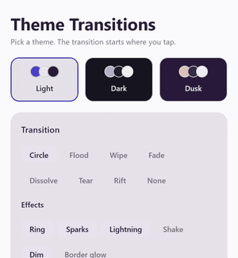

# Theme Transitions

Theme switch animations for Compose Multiplatform. Wrap your theme in `AnimatedTheme`, pick a
transition, and the screen changes theme through a circle that grows from the user's tap, a flood
of colour, a wipe, a fade, a dissolve or a rift that tears the screen open. Layer rings, sparks,
lightning, a shake, a dim or a glow on top.

| Circle | Circle + ring | Circle + sparks, lightning |
|:---:|:---:|:---:|
|  |  |  |
| **Flood** | **Wipe 45° + ring** | **Fade** |
|  |  |  |
| **Dissolve** | **Tear + ring, shake** | **Rift** |
|  |  |  |

- **One composable.** No second copy of your UI is composed, and its state survives every switch.
- **Six reveals and a preset**, each with its own options, and **six effects** to mix over them.
  Combinations that cannot work do not compile.
- **Any theme state.** A `Boolean`, an enum, a palette object: anything you can compare with `equals`.
- **Android, iOS and desktop** from one `commonMain` dependency.
- **Measured on a budget phone.** Every transition animates at 60 fps on a Redmi Note 9 (see
  [Performance](#performance)).

## Install

### JitPack

```kotlin
// settings.gradle.kts
dependencyResolutionManagement {
    repositories {
        google()
        mavenCentral()
        maven("https://jitpack.io")
    }
}
```

```kotlin
// build.gradle.kts of your shared (or Android) module
kotlin {
    sourceSets {
        commonMain.dependencies {
            implementation("com.github.M1nexoff.theme-transitions:theme-transitions:0.1.0")
        }
    }
}
```

In an Android-only project, put the same line in `dependencies { implementation(...) }`.

### Maven Central

Once a release is on Maven Central (see [PUBLISHING.md](PUBLISHING.md)), no extra repository is
needed:

```kotlin
implementation("io.github.m1nexoff:theme-transitions:0.1.0")
```

## Use

Put `AnimatedTheme` at the root, around your theme:

```kotlin
@Composable
fun App() {
    var dark by rememberSaveable { mutableStateOf(false) }

    AnimatedTheme(
        targetState = dark,
        modifier = Modifier.fillMaxSize(),
    ) { isDark ->
        MaterialTheme(colorScheme = if (isDark) DarkColors else LightColors) {
            Surface(Modifier.fillMaxSize()) {
                Screen(onToggleTheme = { dark = !dark })
            }
        }
    }
}
```

That is a circle growing from wherever the user's finger last went down, which is usually the toggle
they just tapped. Pass `transition` for anything else:

```kotlin
AnimatedTheme(
    targetState = theme,
    transition = Transitions.wipe(angleDegrees = 45f, effects = listOf(Effects.ring(Color.Cyan))),
) { shown -> AppTheme(shown) { App() } }
```

### Three rules

1. **Build the theme from the lambda's parameter, never from `targetState`.** After a switch,
   `content` keeps the old state for one more frame so that frame can be frozen. A theme read straight
   from your own state would already be the new one, and the transition would reveal nothing.
2. **Paint an opaque background.** The transition reveals the frame your content drew. A `Surface` or
   `Modifier.background` filling the screen does it.
3. **Wrap the whole screen.** `AnimatedTheme` covers only its own bounds.

## Transitions

`Transitions` has one factory per reveal. Every reveal takes `durationMillis`, `easing` and
`effects`; those that open from a point also take `origin`.

| Reveal | What it does | Own options | Defaults |
|---|---|---|---|
| `circle()` | The new theme grows in a circle from the origin. **The default.** | | 650 ms, `FastOutSlowInEasing` |
| `flood(color)` | A circle of `color` covers the screen, then shrinks back into the origin over the new theme | `color` | 900 ms, `FastOutSlowInEasing` |
| `wipe()` | A straight edge sweeps across the screen | `angleDegrees`: 0 left to right, 90 top to bottom, any angle between | 600 ms, `FastOutSlowInEasing`, 90° |
| `fade()` | Crossfade | | 450 ms, `FastOutSlowInEasing` |
| `dissolve()` | The old theme breaks into tiles that vanish in random order | `tileSize` | 700 ms, `LinearEasing`, 12 dp |
| `tear()` | A ragged hole that wobbles as it grows | | 2 s, `LinearOutSlowInEasing` |
| `rift(glow, backdrop)` | **Preset:** `tear` with dim, a flickering ring, sparks, lightning, shake and a border glow | `lightning`, `scrim` | Same as `tear` |
| `none()` | Switches at once | | |

`origin` is `TransitionOrigin.Touch` by default: the last touch inside `AnimatedTheme`, or the centre
when there was none in the last five seconds, as when the system turns dark mode on. `Center` and
`Fraction(x, y)` fix it instead; a fraction outside `0..1` sweeps in from off screen.

## Effects

`Effects` makes the layers to put over a reveal:

| Effect | What it draws | Works with |
|---|---|---|
| `ring(color, width, flicker)` | A line along the edge between the themes | Every reveal but `fade` and `dissolve` |
| `sparks(color, count)` | Sparks spiralling in towards the edge | `circle`, `flood`, `tear` |
| `lightning(color, bolts)` | Bolts crackling outward off the edge | `circle`, `flood`, `tear` |
| `shake(strength, backdrop)` | Shakes the screen; `backdrop` fills the strips it uncovers | Every reveal |
| `dim(color, maxAlpha)` | Dims the screen as the reveal starts, so bright effects read on a light theme | Every reveal |
| `borderGlow(color)` | A glow rattling round the screen's edge | Every reveal |

Each effect draws on its own layer — dim, then ring, sparks and lightning, then the glow — whatever
order you list them in. The "works with" column is checked by the compiler: `effects` on `fade()`
only takes effects that need no edge, so `Transitions.fade(effects = listOf(Effects.lightning(c)))`
does not compile.

### Colours that follow the theme

`transition` is read at the moment of each switch, so build it from the same state as the theme and
its colours will suit the theme being switched *to*:

```kotlin
enum class AppTheme(val scheme: ColorScheme, val accent: Color) { Light(...), Dark(...), Dusk(...) }

var theme by rememberSaveable { mutableStateOf(AppTheme.Light) }

AnimatedTheme(
    targetState = theme,
    transition = Transitions.circle(
        effects = listOf(Effects.ring(theme.accent), Effects.sparks(theme.accent)),
    ),
) { shown ->
    MaterialTheme(colorScheme = shown.scheme) { /* ... */ }
}
```

The same goes for a different transition per theme: `transition = if (theme.isDark) ... else ...`.

### Behaviour worth knowing

- **Switching again mid-transition** freezes the screen as it stands, the running transition's frame
  included, and plays the new transition over it. The older one's effects fade out over 150 ms.
- **Animations off.** When the composition's `MotionDurationScale` is 0, which on Android means
  animations are turned off in the system settings, the theme changes at once. So it does with
  `none()`, a duration of 0, or when the box is resized mid-transition.
- **Late frames pause, they don't skip.** A frame that comes late, typically the one your app
  recomposes in the new theme on, moves the transition on by at most two frames' worth.
- **Wrong arguments fail early.** A negative duration, count, width or strength, a tile size of 0 or
  a dim outside `0..1` throws when the transition is built.

## Performance

Measured on a **Redmi Note 9** (MediaTek Helio G85, Mali-G52 MC2, Android 12, 1080 × 2340, 60 Hz), with
the demo's release build and `scripts/bench.sh`, which counts the vsyncs SurfaceFlinger presented no
new frame on. Ten switches per transition over the demo's Material 3 screen:

| Transition | Smooth during the animation | Vsyncs missed at the switch, per switch |
|---|---:|---:|
| circle | 98.2% | 5.4 |
| circle + ring, sparks, lightning, dim | 100% | 7.1 |
| flood | 99.8% | 6.1 |
| wipe | 99.7% | 5.3 |
| wipe 45° | 100% | 6.5 |
| fade | 99.5% | 4.7 |
| dissolve | 100% | 5.0 |
| tear | 99.9% | 5.6 |
| rift | 99.9% | 7.4 |
| *redraw: the screen alone, no transition drawn* | *100%* | *5.4* |
| *redraw over a flat background* | *99.7%* | *0.1* |

**Once it starts, every transition runs at 60 fps**: what it misses during the animation is a single
frame now and then, and a few in the first, still cold transition of a run. The frames missed at the
switch are as many with no transition drawn at all (`redraw`) and none over a flat background, so they
come from the screen, not the transition:

- **Freezing the old theme** draws your whole screen once more into a bitmap: 15–30 ms on this phone,
  depending on the screen.
- **Your app recomposing in the new theme.** `MaterialTheme` hands out its colours through a static
  composition local, so everything below it recomposes on the frame the theme changes, transition or
  not: 60–120 ms for the demo's screen on this phone.

If a switch hitches on a slow phone, the second is the one to cut: provide your colours through a
`compositionLocalOf` (dynamic), so only what reads a colour recomposes, and ship a baseline profile.

## How it works

The UI is composed once. On a switch, `AnimatedTheme` freezes the screen into a bitmap, recomposes
the UI in the new theme, and draws the bitmap over it where the new theme has not reached yet. The
effects start on the very next frame, over the still-live old theme, so the tap gets an immediate
answer.

Each reveal draws the old frame the cheapest way its shape allows. Clipping a full-screen image to an
arbitrary shape costs the GPU a coverage mask the size of the screen every frame; measured on a Helio
G99, that alone took 25–30 ms. None of the reveals does it:

| Reveal | The old frame is drawn as |
|---|---|
| circle, flood | One very thick circle stroke filled with the frozen frame: inner edge the circle, outer edge past every corner. An anti-aliased circle is a cheap analytic draw on any GPU. |
| wipe | A convex polygon of at most five points filled with the frozen frame. A straight sweep also clips the live theme to a rect, which is free. |
| fade | The frozen frame with alpha. |
| dissolve | Android 10+: one textured mesh. The tiles are sorted by when they vanish, so the ones left are always the end of one prebuilt array, and a frame only moves an offset into it. Elsewhere one image call per tile, with tiles kept large before Android 10. |
| tear | Android 10+: a textured mesh covering exactly the outside of the hole, with a hair-thin line of the old frame itself along the edge to hide the mesh's jagged rim. Before Android 10, and on iOS and desktop, a clip. |

Edges are drawn as raw line segments rather than stroked paths, which cost 12 ms of GPU on the G99,
and nothing is allocated per frame.

`theme-transitions/src/desktopTest` renders every reveal off screen through Skia and checks the
pixels: the new theme where it has opened, the old one where it has not, and nothing left once a
transition ends, including after switches made mid-transition.

## Platforms

| | |
|---|---|
| Android | minSdk 23. Checked on Android 6, 9, 12 and 16. |
| iOS | `iosArm64`, `iosSimulatorArm64`. Not measured on a device. |
| Desktop | JVM 11+ |
| Kotlin | 2.2.20 or newer |
| Compose Multiplatform | 1.11.1 or newer |

## Demo

`demo/` holds a screen with three themes, a playground that sets the reveal, its effects and options,
and **Play all**, which runs every transition and its variants through the three themes. The screen is
shared, with a thin host per platform:

| Platform | Run it |
|---|---|
| Desktop | `./gradlew :demo:desktopApp:run` |
| Android | `./gradlew :demo:androidApp:installDebug`. Judge smoothness on `installRelease` (minified, debug-signed), never on a debug build. |
| iOS | Open `demo/iosApp/iosApp.xcodeproj` in Xcode on a Mac and run. To run on a device, set your team in `demo/iosApp/Configuration/Config.xcconfig`. |

The Android SDK location goes in `local.properties` (`sdk.dir=...`), as in any Android project.

## Build

```sh
./gradlew :theme-transitions:desktopTest                  # geometry and rendering tests
./gradlew :theme-transitions:publishToMavenLocal          # every variant, iOS included, from any OS
./gradlew renderPreviews                                  # docs/preview.png
./gradlew renderShowreel -Pffmpeg=<path to ffmpeg>        # docs/showreel: an MP4 and the GIFs above
scripts/bench.sh <adb serial> [case...]                   # frame counts on a phone, release build installed
```

## Credits

The rift is inspired by *Rift Toggle* from [tbahlai/animations](https://github.com/tbahlai/animations),
a collection of Jetpack Compose experiments.

## License

```
Copyright 2026 M1nexoff

Licensed under the Apache License, Version 2.0 (the "License");
you may not use this file except in compliance with the License.
You may obtain a copy of the License at

    http://www.apache.org/licenses/LICENSE-2.0

Unless required by applicable law or agreed to in writing, software
distributed under the License is distributed on an "AS IS" BASIS,
WITHOUT WARRANTIES OR CONDITIONS OF ANY KIND, either express or implied.
See the License for the specific language governing permissions and
limitations under the License.
```
